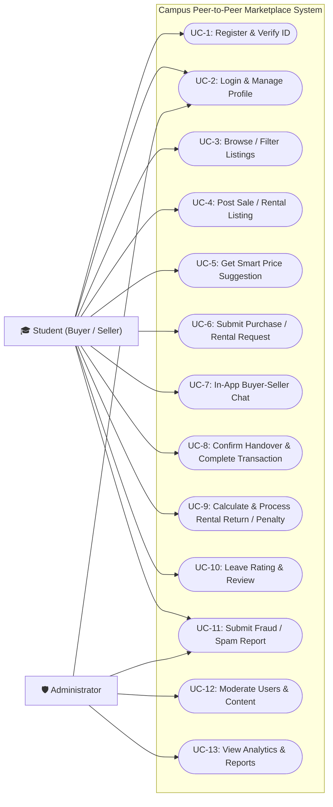
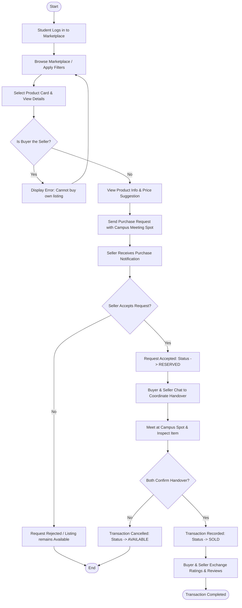
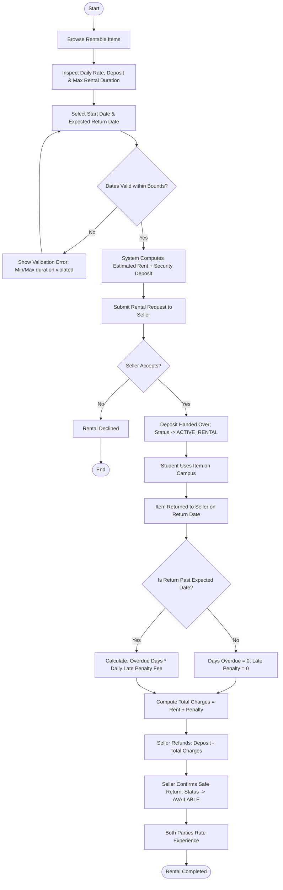
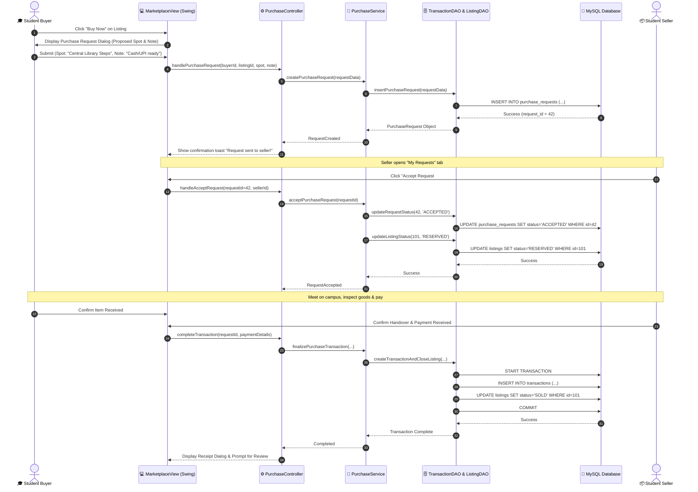
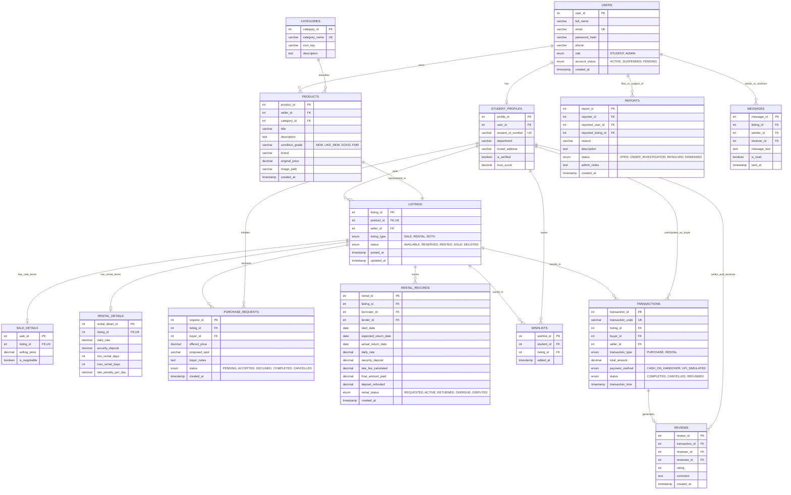

# CAMPUS PEER-TO-PEER MARKETPLACE ("CAMPUSBAZAAR / UNIEXCHANGE")
## Milestone 1: Complete System Analysis and Design Document
**Academic Course:** Object-Oriented Programming Using Java (End-Semester Project)  
**Architecture:** Model-View-Controller (MVC) + Data Access Object (DAO) Pattern  
**Stack:** Core Java (JDK 17+), Java Swing (Custom Modern Aesthetic UI), MySQL, JDBC  

---

## 1. Professional Software Requirement Specification (SRS)

### 1.1 Introduction
The **Campus Peer-to-Peer Marketplace** is an exclusive, closed-loop e-commerce and resource-sharing platform engineered specifically for college students and faculty. Within universities, students experience high recurring expenses each semester purchasing engineering/medical textbooks, lab coats, scientific calculators, stationery, hostel furniture, electronics, and sports items. Concurrently, senior students possess surplus resources they no longer need. Traditional generic classifieds (e.g., OLX, Quikr) suffer from stranger safety concerns, spam listings, lack of physical proximity, payment fraud, and the absence of student-specific rental workflows.

This platform bridges this gap by enforcing college identity verification, localized on-campus pick-up points, flexible peer-to-peer equipment rentals with automated late penalty calculation, rule-based pricing guidance, transparent student-to-student messaging, fraud monitoring, and role-based administrative moderation.

### 1.2 System Purpose and Vision
- **Community Trust:** Strict campus verification (simulated university email OTP / student roll number check) guarantees that buyers and sellers are verified peers within the institution.
- **Resource Circularity:** Reduces educational expenses through direct peer transactions, eliminating commercial middlemen.
- **Micro-Rentals:** Facilitates short-term leasing of items needed temporarily (e.g., lab equipment, drafters, calculators for examination weeks).
- **Academic Rigor:** Designed strictly adhering to standard Object-Oriented Programming (OOP) paradigms in Core Java, enforcing clean abstraction, polymorphism, inheritance, and encapsulation with an MVC architecture.

---

## 2. Functional Requirements (FR)

### FR-01: User Authentication & Verification
- **FR-01.1 Registration:** New students register using Full Name, University Email (`@*.edu` or college domain), Roll/Student ID, Department, Hostel/Campus Address, Phone Number, and Password.
- **FR-01.2 Password Security:** Passwords must be hashed using SHA-256 with salting before storage in MySQL; plain-text passwords are never stored.
- **FR-01.3 Simulated Student Verification:** System triggers an interactive email verification code / campus ID credential check simulator. Unverified accounts cannot list items or send buy/rent requests.
- **FR-01.4 Role-Based Login:** Users authenticate as either `STUDENT` or `ADMINISTRATOR`. Role-based access control (RBAC) dynamically renders respective dashboards.

### FR-02: Product & Listing Management
- **FR-02.1 Category Classification:** Products belong to standardized categories (e.g., Academic Books, Electronics, Lab Equipment, Hostel & Living, Sports & Cycles, Stationery).
- **FR-02.2 Listing Specialization:**
  - **Sale Listing:** Includes selling price, original retail price, item condition (Brand New, Like New, Good, Fair), description, and availability status.
  - **Rental Listing:** Extends listing with rental rate per day, security deposit, minimum rental duration (days), maximum rental duration (days), and daily late penalty fee rate.
- **FR-02.3 Image Attachment:** Image file paths are stored, supporting local asset previews in the UI.
- **FR-02.4 Ownership Authorization:** Only the original seller or an administrator can modify or delist an item.

### FR-03: Rule-Based Smart Price Suggestion Engine
- Evaluates category depreciation base rate + condition multiplier + age factor against existing platform listings.
- Provides a recommended pricing range ("Bargain", "Fair Campus Value", "Overpriced") to prevent student price gouging.

### FR-04: Marketplace Browsing, Filtering & Search
- **FR-04.1 Search:** Keyword search across titles, authors, brands, and descriptions.
- **FR-04.2 Multi-Criteria Filters:** Filter by listing type (Sale vs. Rental), category, price range, condition, and availability.
- **FR-04.3 Sorting:** Sort by Price (Low-to-High, High-to-Low), Recency (Newest first), and Condition rating.

### FR-05: Purchase Request & Transaction Lifecycle
- **FR-05.1 Buy Request:** Buyer sends a request with an optional message and proposed campus meeting location (e.g., Central Library, Hostel Block B, Cafeteria).
- **FR-05.2 Seller Decision:** Seller can accept or decline. Upon acceptance, the listing status updates to `RESERVED`.
- **FR-05.3 Handover & Completion:** Both parties confirm exchange and payment (Cash on Delivery or UPI simulated). Listing status transitions to `SOLD`.

### FR-06: Product Rental Lifecycle & Penalty Calculation
- **FR-06.1 Rental Booking:** Student specifies start date, expected return date, and agrees to the daily rate and security deposit.
- **FR-06.2 Active Rental:** Upon seller acceptance and handover, the rental transitions to `ACTIVE`.
- **FR-06.3 Return Processing:**
  $$\text{Rental Charge} = \text{Days Kept} \times \text{Daily Rate}$$
  $$\text{Late Penalty} = \max(0, \text{Days Overdue}) \times \text{Penalty Rate per Day}$$
  $$\text{Total Deducted} = \text{Rental Charge} + \text{Late Penalty}$$
  $$\text{Deposit Refunded} = \max(0, \text{Security Deposit} - \text{Total Deducted})$$
- **FR-06.4 Return Confirmation:** Seller confirms item receipt in good condition; deposit settlement is registered.

### FR-07: Wishlist Management
- Students can toggle products to their personal Wishlist for quick access and price tracking.

### FR-08: Peer-to-Peer Messaging
- In-app threaded conversations tied to specific product listings between buyer and seller for coordination of inspection and handover.

### FR-09: Reviews and Peer Ratings
- Post-transaction, buyer and seller can rate each other (1 to 5 stars) with a text review. Average reputation score is displayed on student profiles.

### FR-10: Fraud & Safety Reporting
- Students can flag suspicious listings, non-responsive users, damaged rental items, or inappropriate content.
- Generates report tickets with evidence logs for administrative review.

### FR-11: Administrator Governance & Oversight
- Admin dashboard displaying campus transaction metrics, total active listings, active rentals, and pending reports.
- Ban/suspend malicious accounts, remove flagged listings, and oversee audit logs.

---

## 3. Non-Functional Requirements (NFR)

- **NFR-01 Security & Data Integrity:**
  - SHA-256 password hashing with salt.
  - 100% Parameterized queries using `PreparedStatement` to eliminate SQL injection vulnerabilities.
  - Multi-table operations encapsulated in database transactions (`connection.setAutoCommit(false)`, `commit()`, `rollback()`).
- **NFR-02 Performance & Responsiveness:**
  - GUI operations remain smooth with asynchronous background threads or optimized event dispatching.
  - DB queries indexed on foreign keys and frequently searched columns (`category_id`, `status`, `user_id`).
- **NFR-03 Usability, Aesthetic & Visual Delight ("Cute, Clean & Student-Centric"):**
  - **Aesthetic Theme:** Soft modern pastel palette (Warm Lilac / Lavender, Mint Green for 'Available', Soft Coral / Rose for 'Rentals/Alerts', Deep Slate Charcoal for typography).
  - **Visual Elements:** Rounded card layouts, soft badges, status pills ("🟢 Available", "🟡 Reserved", "🔴 Sold", "⏳ On Rent"), custom avatar placeholders, and emoji/icon accents.
  - **Safety Confirmations:** Beautiful modal dialogs for critical actions (confirm purchase, accept rental, cancel listing).
- **NFR-04 Maintainability & Extensibility:**
  - Strict Model-View-Controller (MVC) separation.
  - Loose coupling via Java Interfaces (`Searchable`, `Rentable`, `Reviewable`, `Reportable`).
- **NFR-05 Portability:**
  - Runs on any platform with Java SE 17+ and MySQL 8.0+.

---

## 4. System Scope and Limitations

### System Scope
- Confined to the university/college campus boundary.
- Supports physical item exchange at predefined campus landmark meeting points.
- Manages complete lifecycle for item sales and rentals.
- Provides dispute and fraud reporting for campus administrative staff.

### System Limitations (Academic Demonstration Boundaries)
- **Simulated Payment Gateway:** Actual monetary transfers (UPI, Cash, NetBanking) are recorded as simulated confirmations rather than invoking live commercial banking APIs (e.g., Stripe, Razorpay) to avoid API keys and recurring cloud costs.
- **Simulated College Email Server:** Verification emails utilize an in-memory/in-app dialog OTP generation service instead of requiring external SMTP relay credentials.

---

## 5. User Roles and Use Cases

### 5.1 Roles
1. **Guest / Unregistered User:** Can view login and registration screens.
2. **Student Buyer:** Browses marketplace, searches, filters, requests purchases, rents items, messages sellers, manages wishlist, reviews sellers, and reports fraud.
3. **Student Seller:** Publishes listings (Sale/Rental), uploads photos, receives requests, accepts/rejects handovers, processes rental returns, reviews buyers.
4. **Administrator:** System overseer who manages user statuses (Active/Suspended), moderates listings, reviews fraud reports, and analyzes system statistics.

### 5.2 Use Case Matrix
| Use Case ID | Use Case Name | Actor(s) | Description |
|---|---|---|---|
| UC-01 | Register Account | Student | Submit student credentials and set password. |
| UC-02 | Verify Student Status | Student, System | Complete college email/ID verification check. |
| UC-03 | Authenticate / Log In | Student, Admin | Authenticate with email/password and access dashboard. |
| UC-04 | Create Sale/Rental Listing | Student Seller | Publish an item for sale or rental with images and terms. |
| UC-05 | Search & Filter Marketplace | Student Buyer | Search listings by title/category/price/type. |
| UC-06 | Submit Purchase Request | Student Buyer | Submit formal buy request to seller. |
| UC-07 | Manage Rental Agreement | Buyer, Seller | Rent item, track duration, compute penalties, confirm return. |
| UC-08 | Send Direct Message | Buyer, Seller | Coordinate item inspection and campus handover. |
| UC-09 | Submit Review & Rating | Buyer, Seller | Rate counterparty upon transaction completion. |
| UC-10 | Submit Fraud Report | Student | Report violation or suspicious listing. |
| UC-11 | Moderate Platform | Administrator | Suspend users, close reports, delete infringing listings. |

---

## 6. System Architecture (MVC + DAO Pattern)

```
+-----------------------------------------------------------------------------------+
|                                 VIEW LAYER (Swing)                                 |
|  [MainFrame] [LoginView] [RegisterView] [StudentDashboard] [MarketplaceCatalogView]|
|  [ProductDetailDialog] [AddListingView] [RentalManagementView] [ChatMessagingView]|
|  [WishlistView] [ReviewDialog] [ReportDialog] [AdminDashboardView]                |
+-----------------------------------------------------------------------------------+
                                          | Events / Actions
                                          v
+-----------------------------------------------------------------------------------+
|                              CONTROLLER LAYER (Java)                              |
|  AuthController, MarketplaceController, ListingController, RentalController,      |
|  TransactionController, MessageController, ReviewController, AdminController      |
+-----------------------------------------------------------------------------------+
                                          | Delegates Work
                                          v
+-----------------------------------------------------------------------------------+
|                              SERVICE LAYER (Business Logic)                       |
|  AuthService, ListingService, RentalService, TransactionService,                  |
|  PriceSuggestionEngine, MessageService, ReviewService, AdminReportService         |
+-----------------------------------------------------------------------------------+
                  |                                           |
                  v                                           v
+--------------------------------------+     +--------------------------------------+
|             MODEL LAYER              |     |          DATA ACCESS OBJECTS (DAO)   |
|  User (Abstract), Student, Admin     |     |  UserDAO, ProductDAO, ListingDAO,    |
|  Product, Listing (Abstract),        |     |  RentalDAO, TransactionDAO,          |
|  SaleListing, RentalListing,         |<--->|  MessageDAO, ReviewDAO, ReportDAO    |
|  RentalAgreement, PurchaseRequest,   |     +--------------------------------------+
|  Transaction, Review, Report, Message|                      | JDBC PreparedStatements
+--------------------------------------+                      v
                                             +--------------------------------------+
                                             |             DATABASE LAYER           |
                                             |              MySQL Engine            |
                                             +--------------------------------------+
```

---

## 7. UML Class Diagram Specification

### 7.1 Class Hierarchy & Relationships

```mermaid
classDiagram
    class User {
        <<Abstract>>
        #int userId
        #String fullName
        #String email
        #String passwordHash
        #String phone
        #UserRole role
        #AccountStatus status
        #Timestamp createdAt
        +getUserId() int
        +getFullName() String
        +getEmail() String
        +getRole() UserRole
        +getStatus() AccountStatus
        +validateCredentials(String email, String rawPassword)* boolean
    }

    class Student {
        -String studentIdNumber
        -String department
        -String hostelAddress
        -boolean isVerified
        -double trustRating
        +getStudentIdNumber() String
        +getDepartment() String
        +getHostelAddress() String
        +isVerified() boolean
        +getTrustRating() double
        +setVerified(boolean v) void
        +updateTrustRating(double newRating) void
    }

    class Admin {
        -String staffCode
        -String adminLevel
        +canModerate() boolean
        +canSuspendUsers() boolean
    }

    User <|-- Student : Inheritance
    User <|-- Admin : Inheritance

    class Searchable {
        <<Interface>>
        +matchesSearch(String query) boolean
        +matchesCategory(int categoryId) boolean
        +matchesPriceRange(double min, double max) boolean
    }

    class Rentable {
        <<Interface>>
        +calculateRentalCost(int days) double
        +calculateLatePenalty(int daysOverdue) double
        +isCurrentlyAvailable() boolean
    }

    class Reviewable {
        <<Interface>>
        +addReview(Review review) void
        +getAverageRating() double
    }

    class Reportable {
        <<Interface>>
        +flagReport(Report report) void
        +getReportStatus() String
    }

    class Product {
        -int productId
        -String title
        -String description
        -int categoryId
        -String conditionGrade
        -String brand
        -String imagePath
        +getProductId() int
        +getTitle() String
        +getConditionGrade() String
        +getImagePath() String
    }

    class Listing {
        <<Abstract>>
        #int listingId
        #Product product
        #Student seller
        #ListingType listingType
        #ListingStatus status
        #Timestamp postedAt
        +getListingId() int
        +getProduct() Product
        +getSeller() Student
        +getListingType() ListingType
        +getStatus() ListingStatus
        +setStatus(ListingStatus s) void
        +getEffectivePrice()* double
    }

    class SaleListing {
        -double sellingPrice
        -double originalPrice
        -boolean isNegotiable
        +getSellingPrice() double
        +getOriginalPrice() double
        +getEffectivePrice() double
        +matchesSearch(String query) boolean
        +matchesCategory(int catId) boolean
        +matchesPriceRange(double min, double max) boolean
    }

    class RentalListing {
        -double dailyRentalPrice
        -double securityDeposit
        -int minRentalDays
        -int maxRentalDays
        -double lateFeePerDay
        +getDailyRentalPrice() double
        +getSecurityDeposit() double
        +getLateFeePerDay() double
        +getEffectivePrice() double
        +calculateRentalCost(int days) double
        +calculateLatePenalty(int daysOverdue) double
        +isCurrentlyAvailable() boolean
        +matchesSearch(String query) boolean
        +matchesCategory(int catId) boolean
        +matchesPriceRange(double min, double max) boolean
    }

    Listing <|-- SaleListing : Inheritance
    Listing <|-- RentalListing : Inheritance
    Searchable <|.. SaleListing : Implements
    Searchable <|.. RentalListing : Implements
    Rentable <|.. RentalListing : Implements

    Listing *-- Product : Composition (Listing owns Product)
    Listing o-- Student : Association (Seller)

    class Transaction {
        <<Abstract>>
        #int transactionId
        #Listing listing
        #Student buyer
        #Student seller
        #double finalAmount
        #TransactionStatus status
        #Timestamp transactionDate
        +processTransaction()* boolean
        +generateReceipt()* String
    }

    class PurchaseTransaction {
        -String meetingLocation
        -PaymentMode paymentMode
        +processTransaction() boolean
        +generateReceipt() String
    }

    class RentalTransaction {
        -Date startDate
        -Date expectedEndDate
        -Date actualReturnDate
        -double rentalFeePaid
        -double penaltyPaid
        -double depositRefunded
        +processTransaction() boolean
        +calculateClosureSettlement() void
        +generateReceipt() String
    }

    Transaction <|-- PurchaseTransaction : Inheritance
    Transaction <|-- RentalTransaction : Inheritance

    Transaction o-- Listing : Association
    Transaction o-- Student : Buyer & Seller

    class Review {
        -int reviewId
        -int transactionId
        -Student reviewer
        -Student reviewee
        -int ratingScore
        -String commentText
        -Timestamp reviewDate
        +getRatingScore() int
        +getCommentText() String
    }

    class Report {
        -int reportId
        -Student reporter
        -int reportedUserId
        -int reportedListingId
        -String reportReason
        -String details
        -ReportStatus status
        +resolve(String adminNotes) void
    }

    Reviewable <|.. Student : Implements
    Reportable <|.. Listing : Implements
    Reportable <|.. Student : Implements
```



---

## 8. Use-Case Diagram



---

## 9. Activity Diagram for Buying and Selling Workflow



---

## 10. Activity Diagram for Product Rental Workflow



---

## 11. Sequence Diagram for Purchase Workflow



---

## 12. Database Entity-Relationship (ER) Diagram



---

## 13. Database Table Definitions and Relationship Explanations

### 13.1 `users`
- **Purpose:** Central entity for all platform actors.
- **Keys:** `user_id` (Primary Key, Auto Increment), `email` (Unique).
- **Constraints:** `email` matches email syntax, `role` IN ('STUDENT', 'ADMIN').

### 13.2 `student_profiles`
- **Purpose:** Extends `users` for student-specific attributes (One-to-One relationship with `users`).
- **Keys:** `profile_id` (PK), `user_id` (FK -> `users.user_id`, UNIQUE), `student_id_number` (Unique).
- **Constraints:** `trust_score` between 0.0 and 5.0.

### 13.3 `categories`
- **Purpose:** Standardized master list of categories.
- **Keys:** `category_id` (PK), `category_name` (Unique).

### 13.4 `products`
- **Purpose:** Represents the physical item metadata.
- **Keys:** `product_id` (PK), `seller_id` (FK -> `student_profiles.profile_id`), `category_id` (FK -> `categories.category_id`).
- **Relationship:** Many-to-One with `categories`, Many-to-One with `student_profiles`.

### 13.5 `listings`
- **Purpose:** Represents the active marketplace posting. Demonstrates polymorphism in database schema design via specialized child tables (`sale_details` and `rental_details`).
- **Keys:** `listing_id` (PK), `product_id` (FK -> `products.product_id`, UNIQUE).
- **Relationship:** One-to-One with `products`.

### 13.6 `sale_details`
- **Purpose:** Specific sale pricing and negotiation attributes (One-to-One with `listings` of type 'SALE').

### 13.7 `rental_details`
- **Purpose:** Specific rental rates, deposits, penalties, and durations (One-to-One with `listings` of type 'RENTAL').

### 13.8 `purchase_requests`
- **Purpose:** Tracks buyer interest, meeting coordination, and negotiations.
- **Keys:** `request_id` (PK), `listing_id` (FK), `buyer_id` (FK -> `student_profiles.profile_id`).

### 13.9 `rental_records`
- **Purpose:** Tracks active rental lifecycles, due dates, calculated penalty fees, and deposit refunds.
- **Keys:** `rental_id` (PK), `listing_id` (FK), `borrower_id` (FK), `lender_id` (FK).

### 13.10 `transactions`
- **Purpose:** Immutable audit record of finalized purchases and rentals.
- **Keys:** `transaction_id` (PK), `transaction_code` (Unique UUID/Hash), `listing_id` (FK), `buyer_id` (FK), `seller_id` (FK).

### 13.11 `wishlists`
- **Purpose:** Many-to-Many association between `student_profiles` and `listings`. Unique composite index on `(student_id, listing_id)`.

### 13.12 `reviews`
- **Purpose:** Verified feedback tied directly to completed `transactions`.
- **Keys:** `review_id` (PK), `transaction_id` (FK), `reviewer_id` (FK), `reviewee_id` (FK). Rating constrained to $1 \le \text{rating} \le 5$.

### 13.13 `reports`
- **Purpose:** Audit and moderation mechanism for suspicious listings or users.
- **Keys:** `report_id` (PK), `reporter_id` (FK), `reported_user_id` (FK, Nullable), `reported_listing_id` (FK, Nullable).

### 13.14 `messages`
- **Purpose:** In-app peer messaging between students regarding a specific listing.
- **Keys:** `message_id` (PK), `listing_id` (FK), `sender_id` (FK), `receiver_id` (FK).

---

## 14. UI/UX & Aesthetic Theme Guidelines ("Cute, Modern & Student-Friendly")

To ensure the Java Swing application looks modern, clean, and delightful:
1. **Color Palette:**
   - Primary Accent: Soft Lavender/Indigo (`#6C5CE7` / `#A29BFE`)
   - Secondary / Cute Pastel: Blossom Pink (`#FD79A8`), Sky Aqua (`#74B9FF`), Mint Green (`#55EFC4`)
   - Backgrounds: Clean Crisp Snow (`#F8F9FD`) and Card White (`#FFFFFF`)
   - Text & Headers: Dark Slate (`#2D3436`) and Subdued Muted Purple (`#636E72`)
2. **Typography & Styling:**
   - Clean sans-serif fonts (`Segoe UI`, `Inter`, `Helvetica Neue`) with explicit visual hierarchy.
   - Rounded corners on product cards, text inputs, search boxes, and buttons via custom Swing painters (`Graphics2D.setRenderingHint(RenderingHints.KEY_ANTIALIASING, ...)`).
3. **Interactive & Cute Touches:**
   - **Status Badges:** Rounded pill tags ("🌸 For Sale", "✨ Rentable", "🟢 Available", "💛 Reserved").
   - **Cute Heart Wishlist Toggle:** Smooth toggle button showing filled pink heart on click.
   - **Avatars:** Initials-based circular badge with pastel background colors.
   - **Toast Notifications:** Gentle slide-in or fade auto-dismissing feedback messages instead of jarring raw alert boxes.
   - **No Dead Buttons:** Every button has hover effects, active ripple or color shift, and wired operational action handlers.

